<p align="center">
  
</p>

<h1 align="center">Enshrouded Server Manager</h1>

<p align="center">
  <b>Install, configure, run and protect Enshrouded dedicated servers on Windows – no JSON, no SteamCMD, no guesswork.</b><br>
  Difficulty presets & all 37 gameplay settings · Roles & passwords · Live players · Autosave rollback · Single-player world import · Backups · UPnP
</p>

<p align="center">
  <a href="https://github.com/clawdroppin/Enshrouded_ServerManager/releases/latest"></a>
  <a href="https://github.com/clawdroppin/Enshrouded_ServerManager/releases"></a>
  
  <a href="LICENSE"></a>
</p>

<p align="center">
  <a href="https://github.com/clawdroppin/Enshrouded_ServerManager/releases/latest"><b>⬇ Download</b></a> ·
  <a href="https://clawdroppin.github.io/Enshrouded_ServerManager/"><b>🌐 Website</b></a> ·
  <a href="docs/USER_GUIDE.md"><b>📖 User guide</b></a> ·
  <a href="CHANGELOG.md"><b>📝 What's new</b></a> ·
  <a href="#-troubleshooting"><b>🛠 Troubleshooting</b></a> ·
  <a href="AGENTS.md"><b>🤖 For developers & AI agents</b></a>
</p>

<p align="center">
  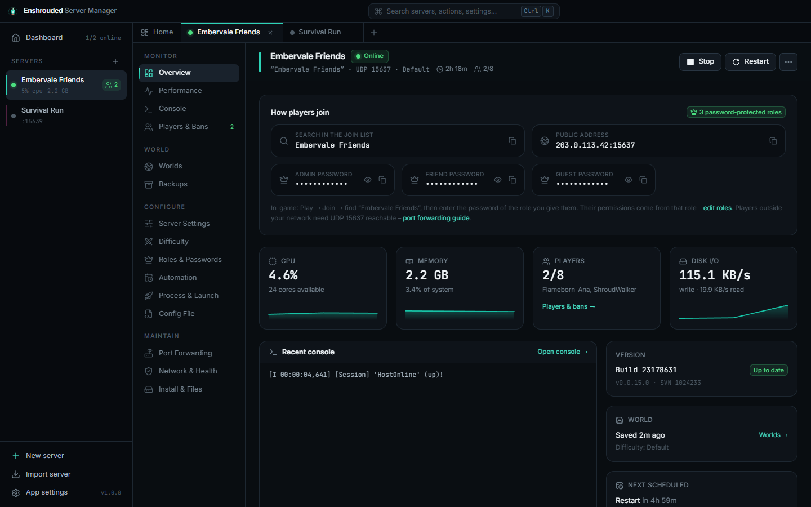
</p>

---

## ✨ Why this manager

<table>
<tr>
<td width="50%" valign="top">

### 🔥 A server in one minute
A wizard picks a free port, creates **Admin / Friend / Guest / Visitor** roles with strong passwords, lets you choose a difficulty and downloads the server through **SteamCMD** – no Steam account needed. Press Start and it's online in seconds.

</td>
<td width="50%" valign="top">

### ⚔️ Difficulty without nanoseconds
Keen's presets – **Default, Relaxed, Hard, Survival** – as cards, or **Custom** with every one of the 37 gameplay settings: player health, Shroud time, enemy damage, day length in *minutes*, tombstone mode, weather, taming… Changed values are marked and one click resets them.

</td>
</tr>
<tr>
<td valign="top">

### 👑 Roles that just work
Enshrouded has no admin console – rights come from the **role password** a player enters. Toggle kick & ban, chests, building, terraforming and Flame Altars per role, reserve slots, copy invite texts. The server's own validation rules are checked live, so it never refuses your config at start.

</td>
<td valign="top">

### 🌍 Worlds you can't lose
Roll back to any of the game's **rolling autosaves** after a griefing, export or reset the world, and **bring your single-player world to the server** in one click. Zip backups run on an interval, on stop and before updates – and can be verified.

</td>
</tr>
<tr>
<td valign="top">

### 👥 Know who's playing
The live player count comes **straight from the server** (Steam query); names and the role they used come from the log. A history shows everyone who ever played with sessions and play time, plus the **ban list with one-click unban**.

</td>
<td valign="top">

### 🤖 Hands-off hosting
Crash recovery that stops on config errors instead of looping, schedules, auto-update that **waits for players to leave**, stop-when-empty, memory/uptime limits, tray mode, start with Windows, Windows toasts and Discord/Slack webhooks. Servers keep running when the app closes.

</td>
</tr>
</table>

### And much more
- **Get found:** one-click **UPnP**, router-by-router guide, **Windows Firewall** fix (including the hidden “Block” rules), double-NAT / **CGNAT** detection and an automatic *“does Steam list my server?”* check after every start
- **Performance:** live CPU, memory, disk, network and per-core charts plus **24 h / 7 d / 30 d history** of players and resources, and an activity timeline
- **Server settings:** name, slots, browser tags (*Looking for players*, languages, focus), text/voice chat, query port finder, bind IP
- **Config file editor** for `enshrouded_server.json` with validation and 30 versions of history – bans and unknown keys are never touched
- **Health check** for files, config, roles, ports, firewall, RAM, disk, version, Steam listing and log errors – with a fix button for each, plus an A2S query tool
- **Several servers** side by side in tabs, **Ctrl+K** command palette, duplicate servers, portable `.enshrouded` server packs
- **Privacy:** passwords and webhooks are encrypted at rest (Windows DPAPI); **streamer mode** hides IPs, passwords and account ids
- **Nothing is ever lost:** rollbacks, restores, imports and resets back up first and move replaced files to a quarantine folder

## 📸 Screenshots

| | |
|:---:|:---:|
| 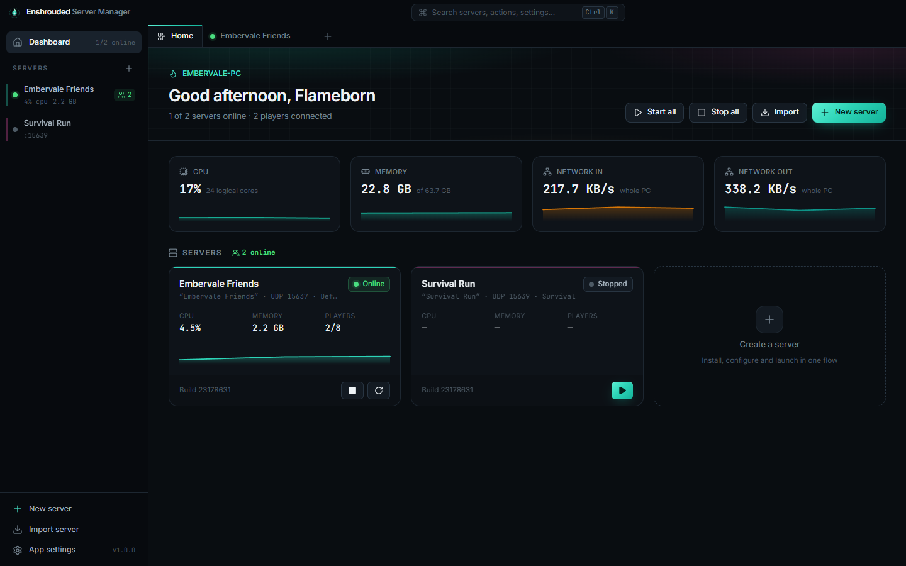 <br> **Dashboard** – every server at a glance | 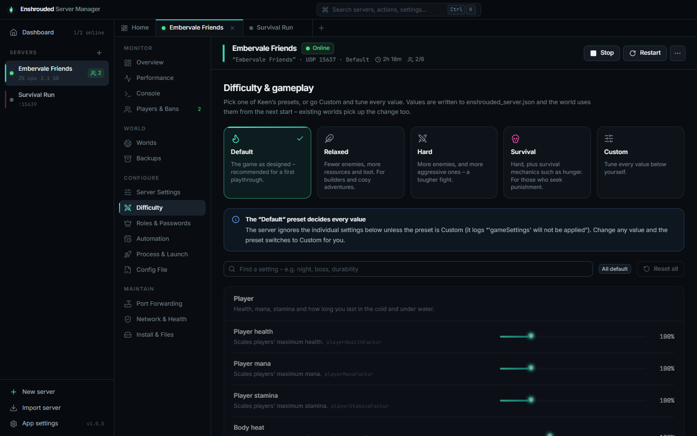 <br> **Difficulty** – presets or every gameplay value |
| 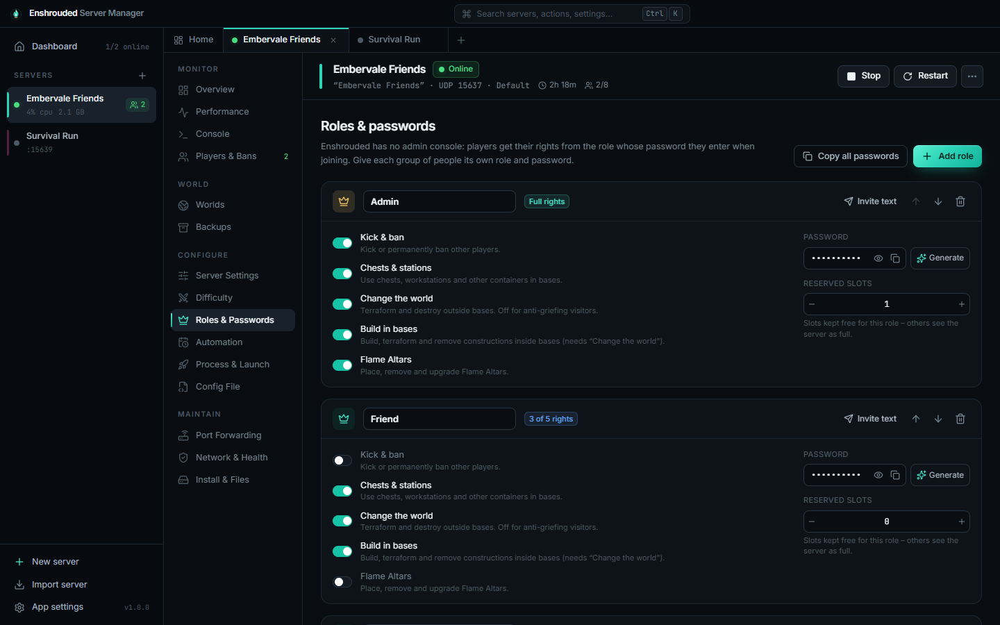 <br> **Roles & passwords** – permissions, slots, invites | 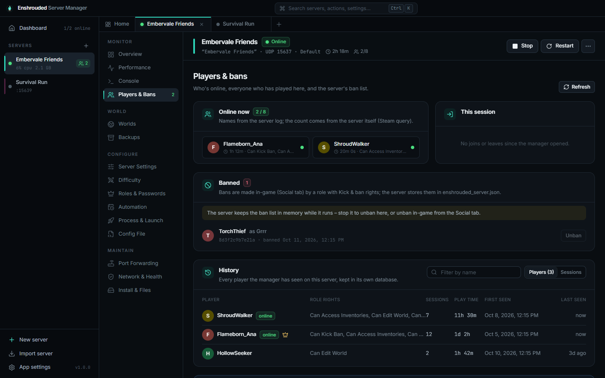 <br> **Players & bans** – online, history, unban |
| 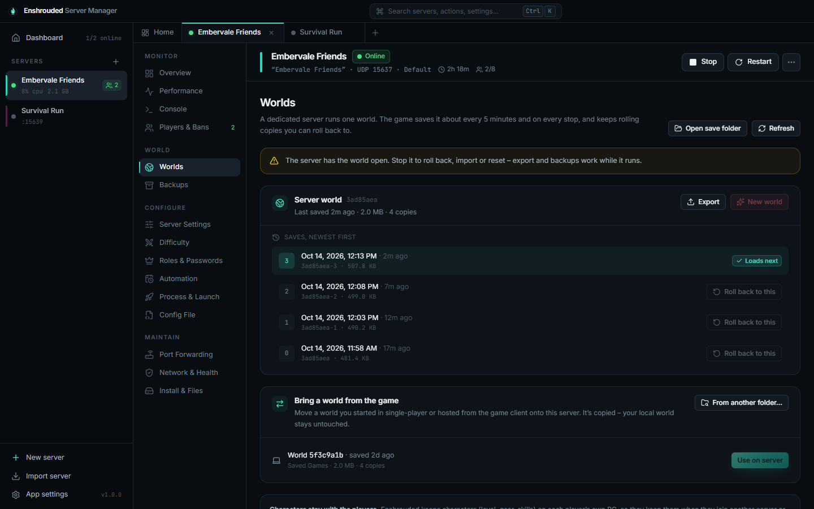 <br> **Worlds** – autosave rollback and world import | 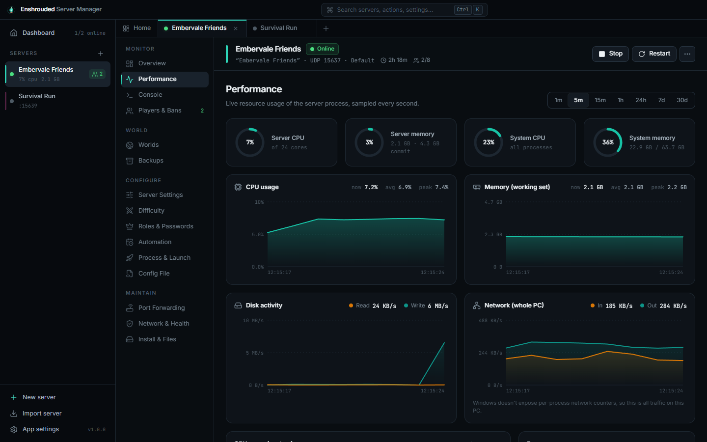 <br> **Performance** – live charts and history |
| 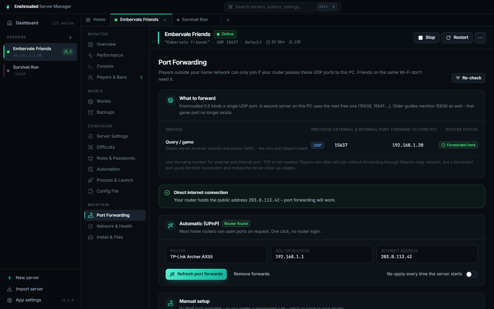 <br> **Port forwarding** – UPnP, firewall, Steam check | 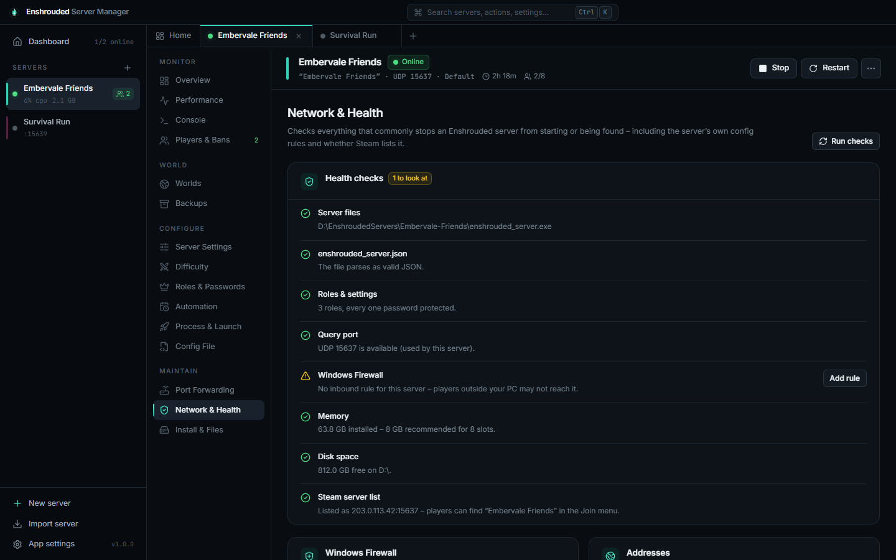 <br> **Network & health** – checks with fixes |
| 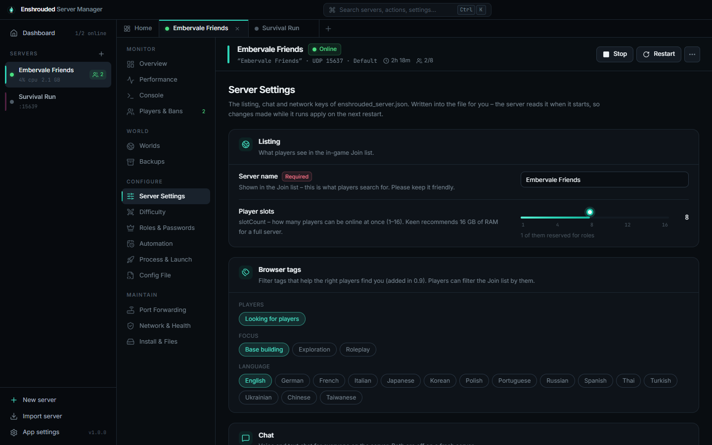 <br> **Server settings** – listing, tags, chat, network | 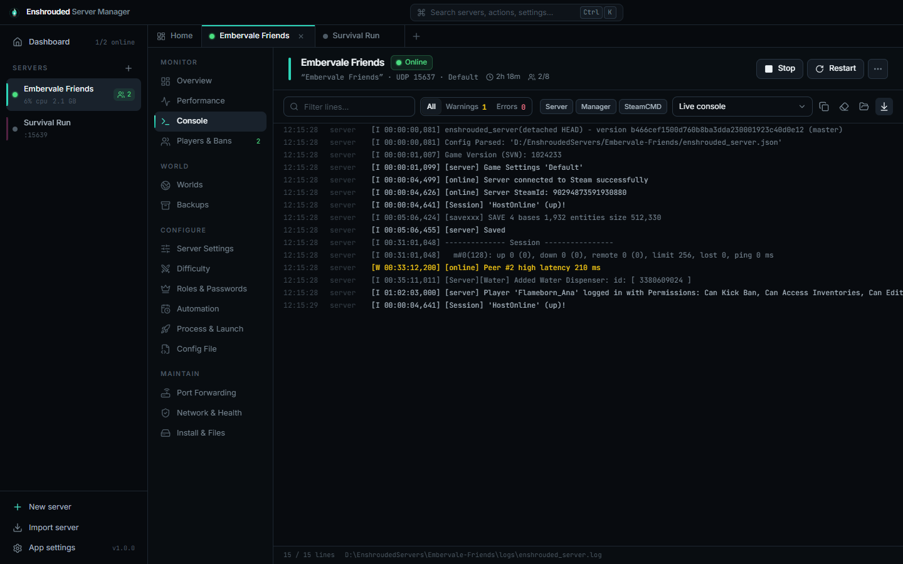 <br> **Console** – live log with filters |

## 🚀 Quick start

1. **Download** `Enshrouded-Server-Manager-Setup.exe` from the [latest release](https://github.com/clawdroppin/Enshrouded_ServerManager/releases/latest) and run it.
   *Windows SmartScreen may warn because the app isn't code-signed yet: **More info → Run anyway**.*
2. Click **New server** → name it → pick a **difficulty** → keep the generated **role passwords** → **Create & install** (about 4 GB download).
3. Press **Start**. The server is online in a few seconds.
4. For friends outside your home network open **Port Forwarding** → *Forward ports automatically* and *Allow through firewall*.
5. Friends open **Play → Join**, search your server name and enter the password of the role you gave them. The **Overview** has copy buttons and an invite text.
6. Already playing a single-player world? **Worlds → Bring a world from the game** before the first start.

The full walkthrough – every screen explained – is in the **[User guide](docs/USER_GUIDE.md)**.

### Downloads

| File | What it is |
|---|---|
| `Enshrouded-Server-Manager-Setup.exe` | Installer (recommended) – data in `%APPDATA%\com.enshroudedservermanager.app` |
| `Enshrouded-Server-Manager.msi` | The same as an MSI package |
| `Enshrouded-Server-Manager-Portable.zip` | No install – unzip anywhere writable; all data stays next to the exe |
| `SHA256SUMS.txt` | Checksums to verify the downloads |

### Requirements

| | |
|---|---|
| **Windows** | 10 or 11, 64-bit (the WebView2 runtime ships with Windows) |
| **Disk** | about 9 GB per server |
| **Memory** | 8 GB for a few friends, 16 GB for a full 16-player server |
| **Network** | one UDP port per server – **15637** by default (15639, 15641 … for more servers) |

## 🛠 Troubleshooting

| Problem | Fix |
|---|---|
| Nobody can find the server | **Network & Health → Steam server list**. If it's not listed: allow the firewall and forward UDP 15637. After a game patch, update the server – players only see servers on their version. |
| Friends can find it but not join | Forward UDP **15637** to this PC, check Port Forwarding for **CGNAT** (then ask your ISP for a public IPv4 or use a tunnel such as playit.gg). |
| The server stops right after starting | The manager shows the server's `Internal Error` / `Config Error` message and pauses auto-restart. Network & Health explains what to fix. |
| A player has the wrong rights | They used another role's password – change passwords under **Roles & Passwords**. |
| “Stop the server first” | Rollbacks, imports, restores and unbans need the server stopped, because it has the files open. |
| Griefing or a bad mistake | **Worlds → Roll back to this** on an earlier autosave (a backup is made first). |

More answers in the [user guide's troubleshooting section](docs/USER_GUIDE.md#13-troubleshooting).

## 🔒 Good to know

- **Your data stays yours.** No accounts, no telemetry. The app only talks to Steam (SteamCMD, api.steamcmd.net for update checks, the public server list for the listing check), a public-IP lookup and your router (UPnP – only when you click).
- **Your router and firewall only change when you click** the buttons for it (or opt in to re-apply UPnP on start).
- **Characters stay with the players** – Enshrouded stores them on each player's PC; the server only holds the world.

## 🧑‍💻 For developers & AI agents

Built with **Tauri 2** (Rust backend) and **React 19 + TypeScript + Tailwind CSS 4**.

```bash
npm install
npm run tauri dev        # full app with hot reload
npm run dev              # UI only, in a browser, with a mock backend
npm run build:all        # installer + MSI + portable zip
```

- **[AGENTS.md](AGENTS.md)** – architecture, repository map, facts verified against the real dedicated server, invariants and the release process. Start here (AI assistants: `CLAUDE.md` points to it).
- **[docs/USER_GUIDE.md](docs/USER_GUIDE.md)** – what every screen does, for users.
- **[CHANGELOG.md](CHANGELOG.md)** – release notes.
- **Website** source is `site/index.html`, published on the `gh-pages` branch (`node scripts/build-site.mjs`).

Development happens on the **`release`** branch (the default branch). Releases are built by GitHub Actions: pushing a `vX.Y.Z` tag publishes the installer, MSI, portable zip and checksums.

## 📄 License

[MIT](LICENSE) © clawdroppin. Enshrouded is a trademark of Keen Games GmbH; this project is not affiliated with or endorsed by them.
